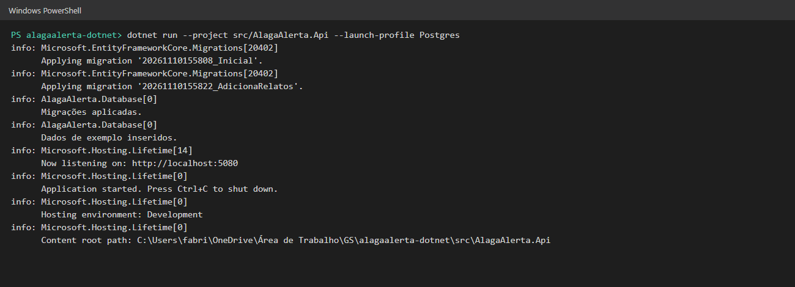
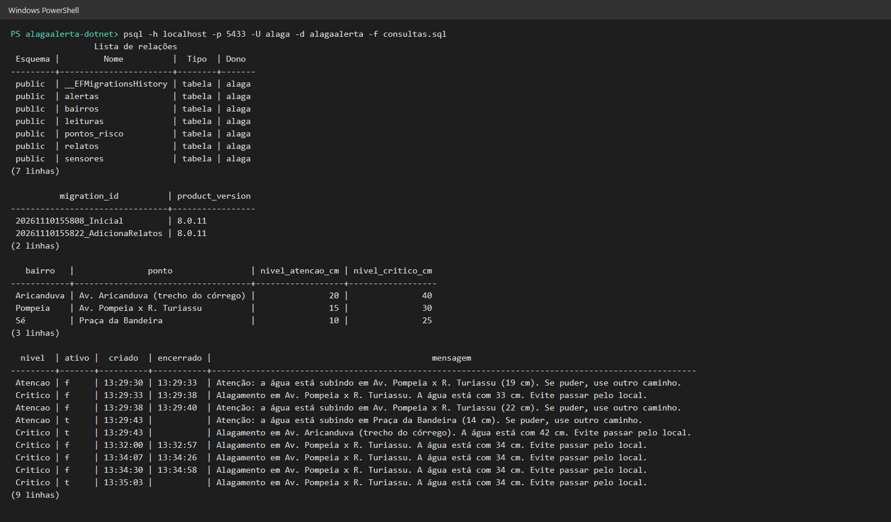
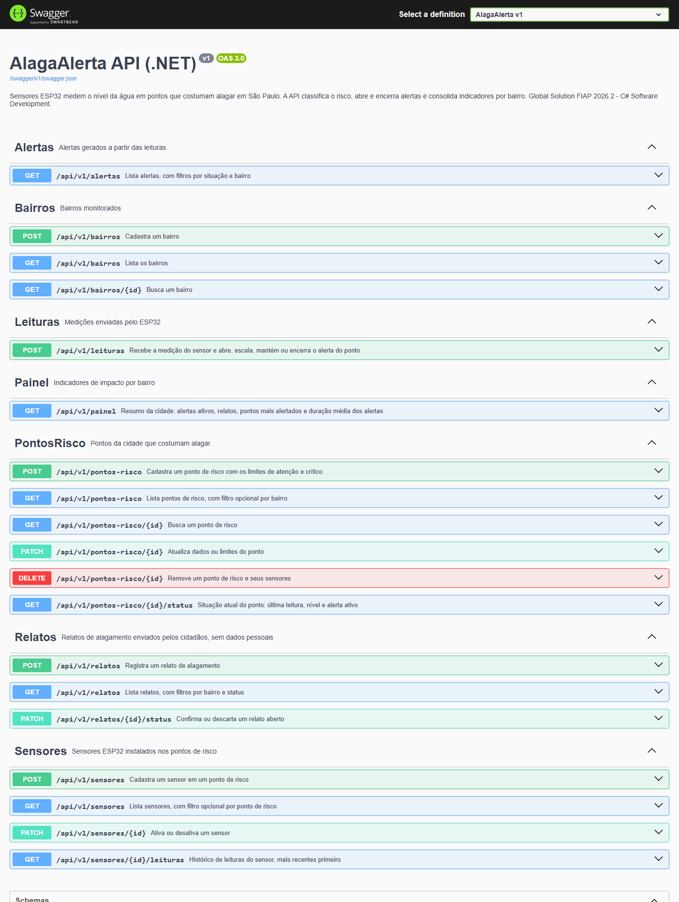
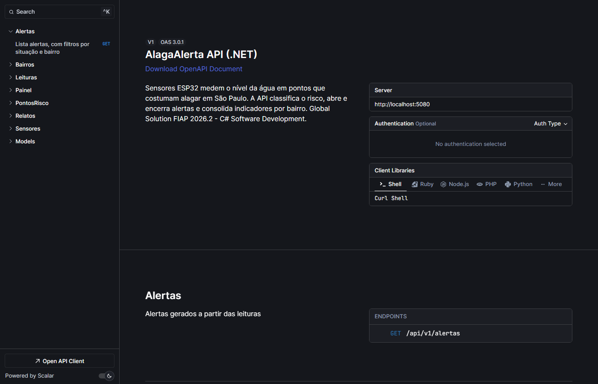
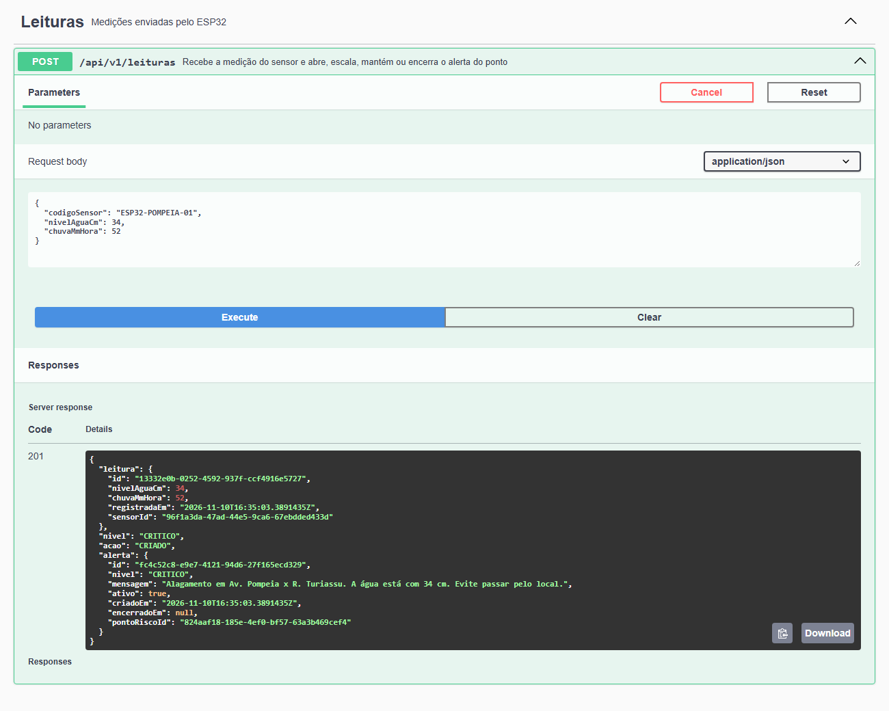
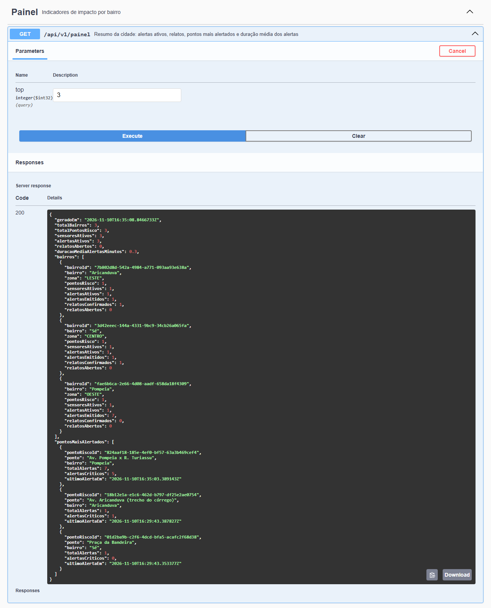
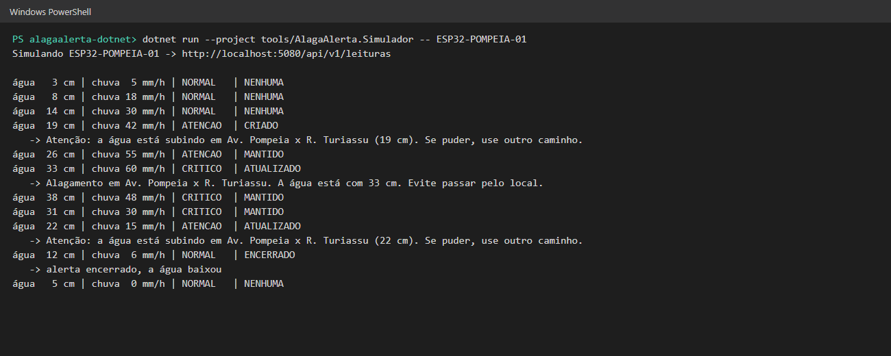
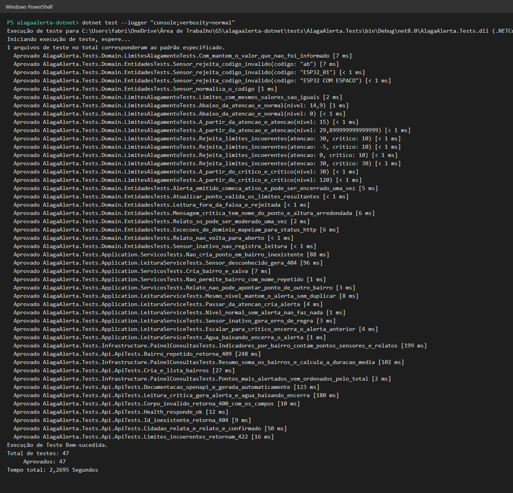

# AlagaAlerta .NET

Web API em C#/.NET 8 da CitizenTech AlagaAlerta para a disciplina de C# Software Development.
Global Solution FIAP 2026.2, Engenharia de Software, 3º ano.

## A solução

Quem passa por ruas que alagam em São Paulo só percebe a água subindo quando já está no meio dela. No AlagaAlerta, um sensor ESP32 mede o nível da água em pontos de risco e manda a leitura para a API. A API classifica o risco pelos limites de cada ponto, abre, escala ou encerra alertas e guarda os relatos que os moradores enviam pelo app.

Este projeto usa o mesmo domínio do backend de SOA (Node/TypeScript) e acrescenta um **painel de indicadores por bairro**: alertas ativos, alertas emitidos, relatos confirmados, pontos com mais alertas e duração média dos alertas. São os indicadores de impacto da ficha da equipe.

| Campo | Resposta |
|---|---|
| Cidade e bairros | São Paulo, SP: Pompeia, Sé (Praça da Bandeira) e Aricanduva |
| Cidadão beneficiado | Pedestres, motoristas de app, idosos e moradores de baixadas |
| ODS | 11 (meta 11.5), 13 (meta 13.1) e 9 |

## Integrantes

| Nome | RM |
|---|---|
| Enzo Miletta | 98677 |
| Fabricio Bettarello | 554638 |
| Renato Luiz Cordão | 556403 |
| Victoria Moura | 555474 |
| Vitor Victorino Couto | 554965 |

## Tecnologias

- .NET 8, ASP.NET Core Web API (controllers)
- Entity Framework Core 8 com PostgreSQL (Npgsql) e migrações
- Swagger (Swashbuckle) e Scalar para a documentação
- xUnit, NSubstitute e `WebApplicationFactory` nos testes
- Docker Compose para o banco e a API

## Estrutura

```
src/
├── AlagaAlerta.Domain           entidades, value object, enums, exceções e interfaces dos repositórios
├── AlagaAlerta.Application      DTOs, interfaces e implementações dos serviços
├── AlagaAlerta.Infrastructure   DbContext, mapeamentos, migrações, repositórios e consultas do painel
└── AlagaAlerta.Api              controllers, tratamento de erros, Swagger e Scalar
tests/
└── AlagaAlerta.Tests            testes de domínio, serviços, consultas e da API
tools/
└── AlagaAlerta.Simulador        console que simula o ESP32 durante uma chuva forte
```

As dependências apontam para dentro: `Api → Application → Domain` e `Infrastructure → Application → Domain`. O domínio não conhece EF Core nem ASP.NET.

## Regra de negócio

Cada ponto de risco tem um `LimitesAlagamento` (nível de atenção e nível crítico, em cm). A cada leitura:

| Nível da água | Situação | Alerta |
|---|---|---|
| abaixo da atenção | NORMAL | encerra o alerta ativo, se houver |
| entre atenção e crítico | ATENCAO | cria ou mantém |
| a partir do crítico | CRITICO | cria ou escala o de atenção |

Nunca há dois alertas ativos no mesmo ponto. Sensor desativado não registra leitura, e relato só pode ser confirmado ou descartado uma vez.

## Como os conteúdos da disciplina aparecem

| Critério | Onde |
|---|---|
| **POO** | `Entidade` abstrata com igualdade por `Id`; entidades com setters privados e comportamento (`Sensor.RegistrarLeitura`, `Alerta.Emitir/Encerrar`, `Relato.Moderar`, `PontoRisco.Atualizar`); `LimitesAlagamento` como value object (`record`); hierarquia `DomainException → NotFoundException/ConflictException` com `StatusCode` sobrescrito; `RepositorioBase<T>` genérico herdado pelos repositórios |
| **Interfaces e injeção de dependência** | `IRepositorio<T>`, repositórios específicos e `IUnitOfWork` no domínio; `IBairroService`, `ILeituraService`, `IPainelConsultas` etc. na aplicação; registro em `AddApplication()` e `AddInfrastructure()`; `TimeProvider` injetado para controlar o relógio nos testes |
| **Web API** | 7 controllers em `/api/v1`, validação com DataAnnotations, respostas 201/204/400/404/409/422 com corpo padronizado `{ erro, detalhes }`, `IExceptionHandler` central, health check em `/health` |
| **EF Core + LINQ** | `AlagaAlertaDbContext` com `IEntityTypeConfiguration`, owned type, índices, chaves estrangeiras com cascade/restrict/set null, nomes em snake_case; duas migrações (`Inicial` e `AdicionaRelatos`); consultas LINQ com filtros opcionais, ordenação, paginação (`Take`), projeções e subconsultas por bairro em `PainelConsultas` |
| **Async/Await** | todos os repositórios, serviços e controllers são assíncronos e propagam `CancellationToken`; migração e seed na inicialização com `MigrateAsync`; simulador usa `HttpClient` e `Task.Delay` |
| **Testes unitários** | 47 testes: regras do domínio, serviços com NSubstitute, consultas do painel com EF InMemory e API com `WebApplicationFactory` |

## Como executar

Requisitos: .NET 8 SDK. Para usar PostgreSQL, Docker.

### Com PostgreSQL

```bash
docker compose up -d db
```

```bash
dotnet run --project src/AlagaAlerta.Api --launch-profile Postgres
```

Na inicialização a API aplica as migrações pendentes e, se o banco estiver vazio, insere os dados de exemplo (3 bairros, 3 pontos, 3 sensores). O banco fica na porta 5433 para não conflitar com o projeto de SOA.

### Sem banco (modo demonstração)

```bash
dotnet run --project src/AlagaAlerta.Api --launch-profile InMemory
```

Usa o provider InMemory do EF Core com os mesmos dados de exemplo.

### Tudo no Docker

```bash
docker compose up --build
```

### Endereços

- Swagger: <http://localhost:5080/swagger>
- Scalar: <http://localhost:5080/scalar/v1>
- OpenAPI (JSON): <http://localhost:5080/swagger/v1/swagger.json>
- Health check: <http://localhost:5080/health>

### Migrações

As migrações já estão em `src/AlagaAlerta.Infrastructure/Data/Migrations`. Para criar uma nova:

```bash
dotnet tool restore
```

```bash
dotnet ef migrations add NomeDaMigracao -p src/AlagaAlerta.Infrastructure -s src/AlagaAlerta.Api -o Data/Migrations
```

### Simular uma chuva forte

Com a API rodando:

```bash
dotnet run --project tools/AlagaAlerta.Simulador -- ESP32-POMPEIA-01
```

Saída esperada (resumida):

```
água  19 cm | chuva 42 mm/h | ATENCAO  | CRIADO
água  33 cm | chuva 60 mm/h | CRITICO  | ATUALIZADO
água  22 cm | chuva 15 mm/h | ATENCAO  | ATUALIZADO
água  12 cm | chuva  6 mm/h | NORMAL   | ENCERRADO
```

### Testes

```bash
dotnet test
```

## Endpoints (`/api/v1`)

| Método | Rota | Descrição |
|---|---|---|
| POST | `/bairros` | Cadastra bairro |
| GET | `/bairros` · `/bairros/{id}` | Lista / busca bairros |
| POST | `/pontos-risco` | Cadastra ponto de risco com os limites |
| GET | `/pontos-risco?bairroId=` · `/pontos-risco/{id}` | Lista / busca pontos |
| PATCH · DELETE | `/pontos-risco/{id}` | Atualiza / remove ponto |
| GET | `/pontos-risco/{id}/status` | Situação atual do ponto |
| POST | `/sensores` | Cadastra sensor ESP32 |
| GET | `/sensores?pontoRiscoId=` | Lista sensores |
| PATCH | `/sensores/{id}` | Ativa ou desativa sensor |
| GET | `/sensores/{id}/leituras?limite=` | Histórico de leituras |
| POST | `/leituras` | Recebe a medição do ESP32 e avalia o alerta |
| GET | `/alertas?ativos=true&bairroId=` | Lista alertas |
| POST | `/relatos` | Cidadão relata alagamento |
| GET | `/relatos?bairroId=&status=` | Lista relatos |
| PATCH | `/relatos/{id}/status` | Confirma ou descarta relato |
| GET | `/painel?top=` | Indicadores por bairro e pontos com mais alertas |

Exemplos prontos em [`requests.http`](requests.http).

## Dados e privacidade

Os relatos não guardam nome, telefone nem e-mail, só bairro, descrição, intensidade e localização opcional. Coordenadas e leituras do seed são aproximadas e simuladas.

## Evidências

### API subindo no PostgreSQL e aplicando as migrações



### Tabelas, histórico de migrações e dados no banco



### Documentação no Swagger



### Documentação no Scalar



### Leitura crítica do ESP32 gerando alerta



### Painel de indicadores por bairro



### Simulador: a água sobe, o alerta escala e é encerrado



### Testes



O uso de IA está registrado em [`prompts.md`](prompts.md).
